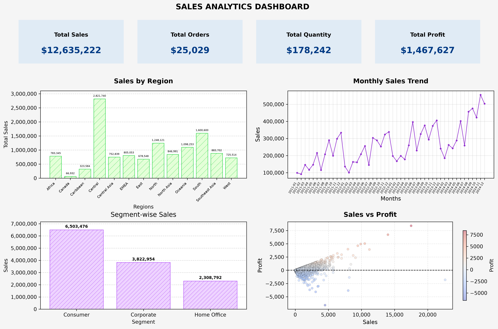

# 📊 Sales Data Analysis & Dashboard

<p align="center">
  
</p>

<p align="center">
  <b>Python | Pandas | NumPy | Matplotlib | Seaborn | Data Visualization</b>
</p>

<p align="center">
  A Python-based Sales Data Analysis project focused on data cleaning, exploratory data analysis, business insights, and dashboard creation.
</p>

---

## 📌 Project Overview

This project focuses on analyzing sales data using Python to discover meaningful business insights and understand sales performance.

The project includes data cleaning, preprocessing, exploratory data analysis (EDA), statistical analysis, and data visualization.

A Sales Analytics Dashboard is also created using Matplotlib to present important business KPIs and sales trends in a visual format.

## 🎯 Project Objectives

- Analyze overall sales and profit performance.
- Identify top-performing products.
- Analyze region-wise sales performance.
- Understand category-wise profit distribution.
- Analyze monthly sales trends.
- Compare sales and profit relationships.
- Build a visual Sales Analytics Dashboard.

## 🛠️ Technologies & Libraries Used

| Technology | Purpose |
|---|---|
| Python | Programming Language |
| Pandas | Data Cleaning & Analysis |
| NumPy | Numerical Operations |
| Matplotlib | Data Visualization |
| Seaborn | Statistical Visualization |
| Jupyter Notebook | Development Environment |

## 📂 Project Structure

```text
Sales-Data-Analysis-Dashboard/
│
├── project.ipynb
├── Dataset.csv
├── README.md
├── requirements.txt
│
└── images/
    ├── dashboard.png
    ├── sales by region.png
    ├── profit by category.png
    ├── segment-wise sales.png
    ├── monthly sales trend.png
    ├── sales vs profit.png
    ├── category-wise sales profit cost.png
    └── Region-wise category sales.png
```

## 🧹 Data Cleaning & Preprocessing

The following data cleaning operations were performed:

1. Loaded the dataset using Pandas.
2. Explored dataset structure and columns.
3. Checked and removed duplicate records.
4. Identified missing values.
5. Filled missing customer names with `Unknown`.
6. Replaced missing profit values with median profit.
7. Removed unnecessary whitespace from product names.
8. Converted order and shipping dates into datetime format.
9. Cleaned sales values by removing commas.
10. Converted sales data into numeric format.

## 📊 Exploratory Data Analysis (EDA)

Performed different analytical operations to understand the dataset:

- Total Sales and Total Profit.
- Average Discount.
- Top 5 Products by Sales.
- Bottom 5 Products by Profit.
- Region-wise Total Sales.
- Category-wise Sales and Profit.
- Segment-wise Sales Analysis.

## 📈 Data Visualizations

### 1. Sales by Region

Analyzes total sales performance across different regions using a bar chart.


### 2. Profit by Category

Shows the contribution of different product categories to total profit using a pie chart.


### 3. Segment-wise Sales

Compares sales performance across different customer segments.


### 4. Monthly Sales Trend

Visualizes monthly sales performance using a line chart to understand sales trends over time.


### 5. Sales vs Profit Analysis

Uses a scatter plot to explore the relationship between sales and profit.


### 6. Category-wise Sales, Profit & Shipping Cost

Compares sales, profit, and shipping costs across different product categories.


### 7. Region-wise Category Sales

Shows category-wise sales distribution across different regions using a stacked bar chart.


---

## 📊 Sales Analytics Dashboard

The project includes a dashboard created using Matplotlib.

### Dashboard Features

- Total Sales KPI
- Total Orders KPI
- Total Quantity KPI
- Total Profit KPI
- Sales by Region
- Segment-wise Sales
- Monthly Sales Trend
- Sales vs Profit Analysis


## ⚙️ Installation & Setup

Follow these steps to run this project on your local machine.

### Step 1: Clone the Repository

```bash
git clone https://github.com/YOUR-USERNAME/Sales-Data-Analysis-Dashboard.git
```

### Step 2: Navigate to Project Folder

```bash
cd Sales-Data-Analysis-Dashboard
```

### Step 3: Install Required Libraries

```bash
pip install -r requirements.txt
```

### Step 4: Open Jupyter Notebook

```bash
jupyter notebook
```

### Step 5: Run the Project

Open `project.ipynb` and run all cells.

**Note:** Keep `Dataset.csv` in the project root folder and use a relative file path in the notebook:

```python
df = pd.read_csv("Dataset.csv")
```

## 📦 Requirements

The required Python libraries are listed in `requirements.txt`:

```text
numpy
pandas
matplotlib
seaborn
jupyter
```

## 💡 Key Learning Outcomes

Through this project, I practiced:

- Data cleaning and preprocessing using Pandas.
- Working with missing and duplicate values.
- Data type conversion and manipulation.
- GroupBy and aggregation operations.
- Exploratory Data Analysis (EDA).
- Creating different types of charts using Matplotlib.
- Building KPI cards and dashboard layouts.
- Presenting business data through visualizations.

## 🚀 Future Improvements

- Add interactive dashboard functionality.
- Include more business performance KPIs.
- Add advanced sales forecasting.
- Improve dashboard design and user experience.
- Explore interactive visualization tools such as Plotly and Power BI.

## 👨‍💻 Author

**Your Name**

Aspiring Data Analyst | Python | SQL | Data Visualization

📌 GitHub: [Your GitHub Profile](https://github.com/YOUR-USERNAME)

---

<p align="center">
  ⭐ If you find this project useful, consider giving it a star!
</p>

<p align="center">
  <b>Thank you for visiting my project! 😊</b>
</p>
